 

<picture>
  <source media="(prefers-color-scheme: dark)" srcset="assets/section-about-dark.svg"/>
  
</picture>

Final-year Software Engineering student at FPT University HCMC (graduating 06/2027), focused on backend development with **C# / ASP.NET Core**.
Most of my work on team projects covers **payments & billing** (VNPay in three projects), **realtime** features with SignalR, **concurrency control**, and **async processing** with RabbitMQ and background workers.

Currently co-building **[Livento – AI Livestream Studio](https://studio.livento.id.vn/)** with a startup team, owning business logic and product workflows.

 

<picture>
  <source media="(prefers-color-scheme: dark)" srcset="assets/section-projects-dark.svg"/>
  
</picture>

| Project | Key contributions |
|:--|:--|
| **[Smart Waterbus](https://github.com/minhvuong0909/waterbus-system)** River-bus ticketing · .NET 8 · SQL Server · SignalR | Commercial backend: checkout, VNPay payment & refund (IPN verification, reconciliation), race-condition fixes with SQL Server app locks + `RowVersion`, transactional email outbox |
| **[InsightVault AI](https://github.com/tuankiet18-dev/InsightVault-AI)** Team knowledge base with RAG · ASP.NET Core · pgvector · RabbitMQ | Backend architecture, RabbitMQ-based AI job processing, workspace billing & credits (VNPay/PayOS), CI and EC2 deployment |
| **[SmartInvoice Shield](https://github.com/tuankiet18-dev/SMARTINVOICE-SHIELD)** E-invoice SaaS with AI/OCR · .NET 9 · PostgreSQL · AWS | VNPay with subscription quotas, invoice management & audit log, permission-based RBAC, OCR pipeline integration |
| **[EVoltStation](https://github.com/nhatanh-dev/EVStation-API)** · [demo](https://evoltstation.io.vn) EV charging management · .NET 9 · SignalR · SQL Server | Realtime charging-session flow over SignalR, overstay fees & rule enforcement via background jobs, walk-in customer flow |

 

<picture>
  <source media="(prefers-color-scheme: dark)" srcset="assets/section-stack-dark.svg"/>
  
</picture>

`C#` `ASP.NET Core` `EF Core` `SignalR` · `PostgreSQL (pgvector)` `SQL Server` `RabbitMQ` · `AWS` `Docker` `GitHub Actions` · `React` `TypeScript`

 

<picture>
  <source media="(prefers-color-scheme: dark)" srcset="assets/section-games-dark.svg"/>
  
</picture>

<table>
<tr>
<td width="50%" valign="top">

<b><a href="https://github.com/nhatanh-dev/flood-route">Flood Route</a></b> 
3D flood-rescue game in Unity, built with AI across code, 3D models, art, music and voice
</td>
<td width="50%" valign="top">

<b><a href="https://banyan-base-airisers.netlify.app/">Banyan Base: Cuội & Moxi</a></b> 
NASA Space Apps Challenge 2026 game (team AI RISERS); 3D assets made with AI tools
</td>
</tr>
</table>

 

<picture>
  <source media="(prefers-color-scheme: dark)" srcset="assets/section-awards-dark.svg"/>
  
</picture>

- 🏆 **Top 4 of 160 teams**, IT Consultant Challenge 2026 (Netcompany × Code Mely), team NEW AURA · [project](https://github.com/tuankiet18-dev/Nordic-Flow)
- 🎓 **Honorable Student of the Trimester**, 4 terms, FPT University
- ☁️ **AWS First Cloud AI Journey (FCAJ)** hands-on program · [workshop](https://github.com/nhatanh-dev/FCAJ_Workshop)
- 🚀 **NASA Space Apps Challenge 2026**, team AI RISERS
- 📜 Coursera specializations, including Software Development Lifecycle · [certificates](https://anhnpn.vercel.app)
