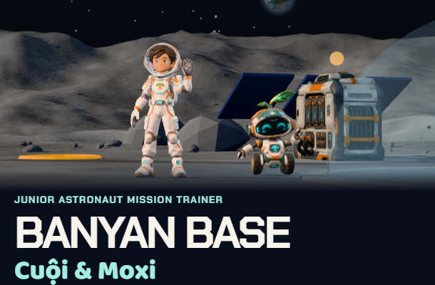

## 👋 Giới thiệu

Tui là **Nhật Anh**, sinh viên năm cuối Kỹ thuật Phần mềm tại **FPT University HCMC** (dự kiến tốt nghiệp 06/2027), định hướng **Backend Developer**.

Trong các dự án nhóm, tui thường làm backend với **C# / ASP.NET Core**, **PostgreSQL** và **SQL Server**. Mảng tui làm nhiều nhất là thanh toán & billing (đã tích hợp VNPay ở 3 dự án), realtime với SignalR, xử lý đồng thời và xử lý bất đồng bộ (RabbitMQ, BackgroundService, transactional outbox). Ngoài ra tui làm frontend với **React** và triển khai trên **AWS / Docker**.

> 🚀 **Hiện tại:** cùng team khởi nghiệp xây dựng **[Livento – AI Livestream Studio](https://studio.livento.id.vn/)**, tui phụ trách nghiệp vụ và luồng xử lý của sản phẩm.

## 🧩 Dự án nổi bật

| Dự án | Mô tả | Phần tui làm |
|:--|:--|:--|
| 🚤 **[Smart Waterbus](https://github.com/minhvuong0909/waterbus-system)** | Đặt vé tàu buýt đường sông theo chặng: thanh toán online, vé QR, soát vé offline, thuyết minh tự động trên tàu. `.NET 8` `SQL Server` `SignalR` `VNPay` | **Commercial backend:** checkout, thanh toán & hoàn tiền VNPay (verify IPN, đối soát `querydr`); chống race condition bằng SQL Server app lock + `RowVersion`; transactional email outbox; phát audio qua SignalR có ACK & fencing token |
| 📚 **[InsightVault AI](https://github.com/tuankiet18-dev/InsightVault-AI)** | Không gian tri thức cho team: upload tài liệu, RAG chat, tóm tắt & so sánh, xuất báo cáo. `ASP.NET Core` `PostgreSQL + pgvector` `RabbitMQ` `MinIO` `Docker` | Thiết kế kiến trúc backend (Clean Architecture); xử lý job AI bất đồng bộ qua RabbitMQ + BackgroundService; billing theo workspace (trừ credit idempotent, VNPay/PayOS); CI và deploy EC2 (Docker Compose, Caddy HTTPS) |
| 🛡️ **[SmartInvoice Shield](https://github.com/tuankiet18-dev/SMARTINVOICE-SHIELD)** | SaaS multi-tenant quản lý hóa đơn điện tử: trích xuất AI/OCR, đánh giá rủi ro thuế. `.NET 9` `PostgreSQL` `React` `AWS` | Tích hợp VNPay + gói subscription/quota; quản lý hóa đơn (soft delete, audit log, export Excel); RBAC theo permission; nối pipeline OCR (validate XSD, Gemini có retry + xoay API key) |
| ⚡ **[EVoltStation](https://github.com/nhatanh-dev/EVStation-API)** · [demo](https://evoltstation.io.vn) | Quản lý trạm sạc xe điện: đặt chỗ, sạc bằng QR, ví điện tử, giám sát realtime. `.NET 9` `SignalR` `SQL Server` | Luồng phiên sạc lõi + SignalR hub đẩy pin, chi phí, thời gian còn lại; phí chiếm chỗ, nợ tài xế, tự động ban/unban bằng BackgroundService; luồng tài xế vãng lai |

Các dự án nhóm nằm ở repo của thành viên khác; link dẫn tới repo gốc, nơi có lịch sử commit của tui.

## 🛠️ Tech stack

- **Backend:** C#, ASP.NET Core, Entity Framework Core, SignalR, REST API, BackgroundService
- **Data & Messaging:** PostgreSQL (pgvector), SQL Server, RabbitMQ
- **Cloud & DevOps:** AWS (EC2, RDS, S3, Cognito), Docker, GitHub Actions
- **Frontend:** React, TypeScript, Tailwind CSS

## 🎮 Game & AI sáng tạo

- **[Banyan Base: Cuội & Moxi](https://banyan-base-airisers.netlify.app/)**: game cho NASA Space Apps Challenge 2026 (team AI RISERS), tui phụ trách dựng 3D asset bằng công cụ AI
- **[Flood Route](https://github.com/nhatanh-dev/flood-route)**: game giải đố giải cứu lũ theo lượt, làm bằng Unity

## 🏅 Hoạt động & thành tích

- 🎓 **Sinh viên Giỏi** 4 học kỳ, FPT University
- ☁️ **AWS First Cloud AI Journey (FCAJ)**: chương trình thực hành AWS · [workshop](https://github.com/nhatanh-dev/FCAJ_Workshop)
- 🚀 **NASA Space Apps Challenge 2026**, team AI RISERS
- 📜 Các chứng chỉ Coursera (Software Development Lifecycle, …): xem tại [portfolio](https://anhnpn.vercel.app)

<b>🇬🇧 English version</b>

 

I'm **Nhat Anh**, a final-year Software Engineering student at **FPT University HCMC** (expected 06/2027), focused on **backend development**.

On team projects I usually own backend work in **C# / ASP.NET Core** with **PostgreSQL** and **SQL Server**. Most of it falls into four areas: payments & billing (VNPay integrated in three projects), realtime with SignalR, concurrency control, and async processing (RabbitMQ, BackgroundService, transactional outbox). I also build frontends with **React** and deploy with **AWS / Docker**.

**Currently:** co-building **[Livento – AI Livestream Studio](https://studio.livento.id.vn/)** with my startup team, where I own the business logic and workflows.

**Featured projects**

- **Smart Waterbus**: commercial backend. Checkout, VNPay payment & refund (signed IPN verification, `querydr` reconciliation), race-condition fixes with SQL Server app locks + `RowVersion`, transactional email outbox, and SignalR audio dispatch with ACK & fencing tokens.
- **InsightVault AI**: designed the backend architecture (Clean Architecture, EF Core + pgvector), RabbitMQ-based AI job processing, workspace billing with idempotent credit consumption (VNPay/PayOS), CI and EC2 deployment.
- **SmartInvoice Shield**: VNPay with subscription/quota rules, invoice management (soft delete, audit log, Excel export), permission-based RBAC, and OCR pipeline integration (XSD validation, Gemini with retry & key rotation).
- **EVoltStation**: core charging-session flow with a SignalR hub streaming live battery, cost and time remaining; overstay fees, driver debt and auto ban/unban via BackgroundService workers.

**Activities:** Excellent Student award (4 semesters) · AWS First Cloud AI Journey · NASA Space Apps Challenge 2026 · Coursera specializations

